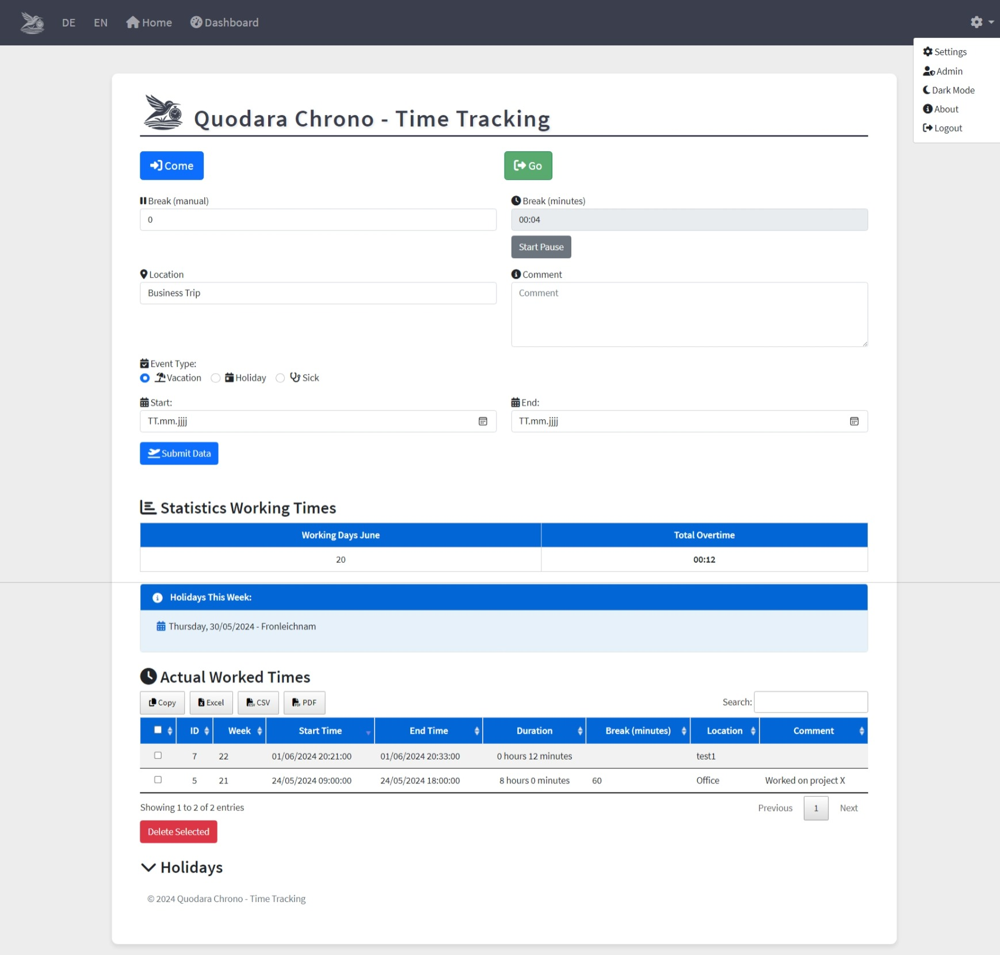
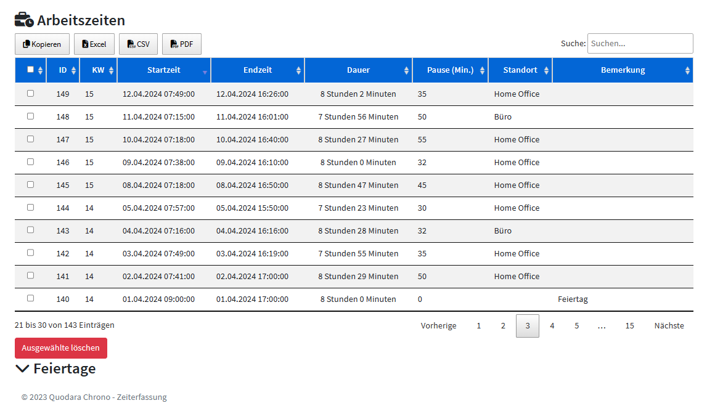
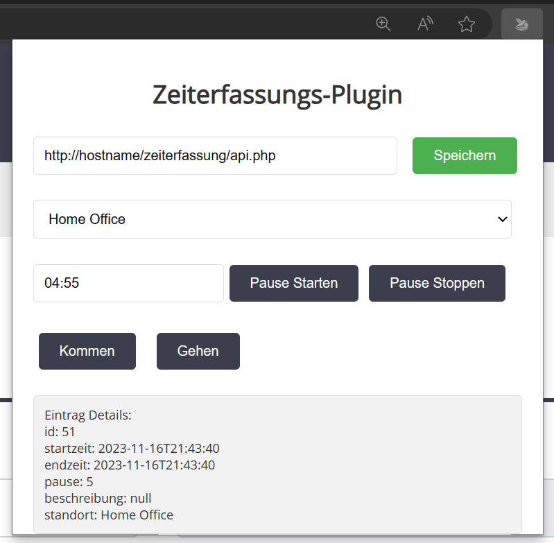
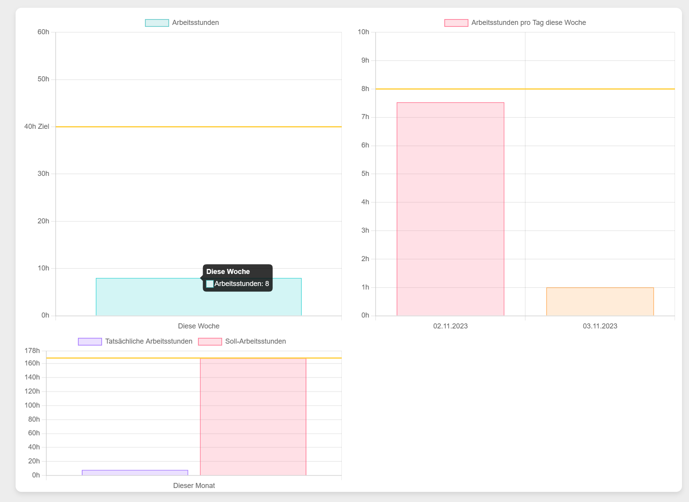
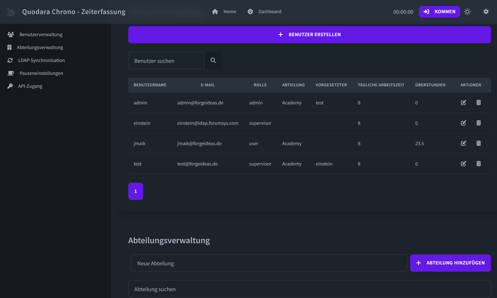
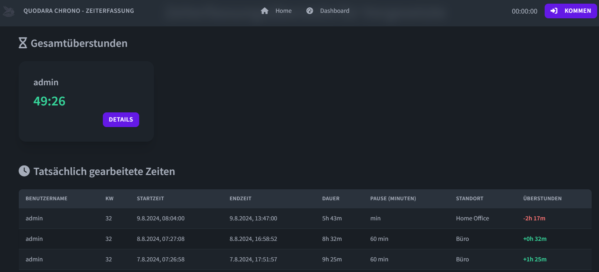
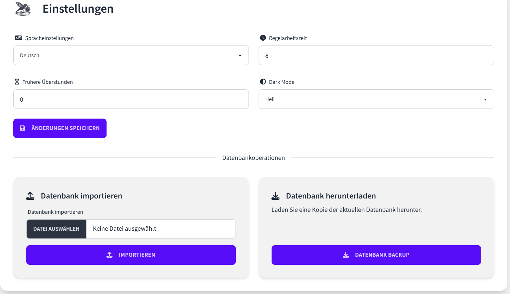
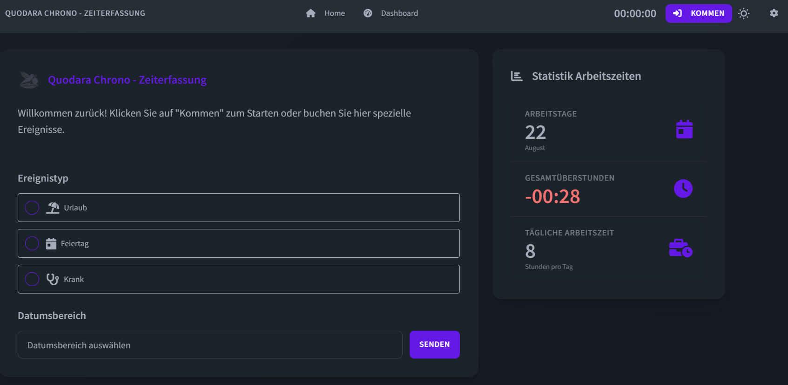

# Quodara Chrono · Zeiterfassung

[](docs/PHP85.md)
[](LICENSE)

Selbst gehostete Zeiterfassung für Beschäftigte, Führungskräfte und Verwaltung: Arbeitszeit, tatsächliche Pausen, Abwesenheiten und nachvollziehbare Korrekturen in einer Webanwendung.

## Video

[](https://www.youtube.com/watch?v=vh1hj4rqv88)

## Funktionsumfang

- **Kommen, Pause, Gehen:** serverseitige Zeitstempel, bestätigte Buchungen und Schutz vor Doppelbuchung bei Wiederholung derselben `event_id` mit identischem Inhalt; Arbeitsort und Notiz optional beim Start. Keine automatisch abgezogenen Mindestpausen.
- **Übersicht und Auswertung:** eigene Arbeitszeitliste, Kalender, Wochen-/Monats-/Jahreswerte, Sollabdeckung und getrennte Anzeige von Arbeit und Abwesenheitsgutschrift; eigener CSV-Export vollständig oder für einen Zeitraum.
- **Arbeitszeitmodelle und Abwesenheiten:** versionierte Sollminuten je Wochentag und Gültigkeitsdatum; Urlaub und Krankheit mit modellbasierter Gutschrift, unter Berücksichtigung freier Tage und hinterlegter Feiertage.
- **Korrekturen und Historie:** begründete Nachträge, Änderungen und Stornierungen mit Freigabe durch eine andere berechtigte Person; Änderungsjournal mit Vorher-/Nachher-Werten und Hinweisen auf offene Klärungen.
- **Team und Verwaltung:** Benutzer, Rollen, Abteilungen und Vorgesetztenzuordnung; berechtigte Teamberichte, aktueller Stempelstatus und datensparsame Abwesenheitswochenansicht.
- **Zugang und Oberfläche:** lokale Anmeldung, eigene Passwortänderung für lokale Konten, optional LDAP-Anmeldung und -Synchronisation; Deutsch, Englisch und Chinesisch sowie Hell-/Dunkelmodus.
- **Schnittstellen:** JWT-REST-API und mitgelieferte [Edge-](time-tracker-extension_edge/) und [Firefox-Erweiterung](firefox_add_on/). Browserinstallation und Integrationsabnahme sind separat erforderlich; siehe [Clientvertrag](docs/extension-contract.md).
- **Optionales Online-Terminal:** Geräteverwaltung, PIN beziehungsweise NFC-Kennung plus PIN und lokaler Python-Kiosk in [terminal-agent/](terminal-agent/). Standardmäßig deaktiviert; Einrichtung mit `APP_TERMINAL_ENABLED=1` **und** Adminfreigabe. Reale NFC-Hardware muss separat geprüft werden; [Betriebsanleitung](docs/TERMINAL.md).

**Grenzen:** keine Offline-Buchungen, automatische Geolocation-Buchung, Urlaubsanspruchsverwaltung oder Lohnabrechnung. Feiertage sind für den eigenen Standort zu prüfen. Die native Kontenverwaltung bietet noch keine zentrale Sperre sämtlicher Zugangsarten; [Zugriffsgrenzen](docs/native-admin-account-access-limits.md). Das Journal ist gegen Änderungen durch die Anwendung geschützt, nicht extern gegen Betreiberzugriff versiegelt.

## Installation

Die Standardinstallation ist die **native PHP-/SQLite-Anwendung**. Das Root-Dockerfile verwendet digest-gepinntes PHP **8.5.12 mit Apache**; Composer und ein Node-Build sind dafür nicht erforderlich.

1. [Sicheren Betrieb und Ersteinrichtung](SECURITY.md) lesen. Außerhalb des Repositorys eine geschützte Environment-Datei mit einem unabhängig erzeugten zufälligen `APP_SETUP_TOKEN` vorbereiten. Es gibt keine Standardkonten.
2. Repository klonen, Image bauen und nur auf Loopback starten:

   ```sh
   git clone https://github.com/storminator89/Zeiterfassung.git
   cd Zeiterfassung
   docker build -t chrono .
   docker run -d --name chrono -p 127.0.0.1:8080:80 \
     --env-file /absoluter/privater/pfad/chrono-setup.env \
     -v chrono-data:/var/lib/chrono chrono
   ```

3. `http://127.0.0.1:8080/register.php` öffnen und mit Setup-Token, gültiger E-Mail und einem Passwort mit mindestens zwölf Zeichen den ersten Administrator anlegen. Danach den Container **ohne Setup-Token** neu erstellen; dasselbe Datenvolume behalten. Die Registrierung schließt nach dem ersten Konto.

Vor öffentlicher Nutzung HTTPS am vertrauenswürdigen Reverse Proxy einrichten; `APP_HTTPS=1` nur bei tatsächlich durchgängigem HTTPS setzen. Eine frische Einrichtung nicht öffentlich freigeben.

Ohne Docker benötigt die native Anwendung PHP **8.5** mit PDO SQLite, SQLite3, mbstring, OpenSSL, ctype, fileinfo und iconv. LDAP benötigt zusätzlich die LDAP-Extension und eine geprüfte TLS-Verbindung; sie ist nicht im Basisimage enthalten. Lokaler Start mit `router.php` und weitere Betriebsdetails stehen in [SECURITY.md](SECURITY.md).

**Daten und Backups:** `APP_DATA_DIR` muss privat, beschreibbar und außerhalb des Webroots liegen; im Container ist es `/var/lib/chrono`. Bestehende Datenbanken aus `assets/db` vor dem Start nach [Migrationsanleitung](SECURITY.md#upgrade-an-existing-installation) übernehmen. Immer die vollständige private Ablage einschließlich Schlüssel offline sichern; der Admin-Datenbankdownload enthält keine Schlüssel. Teilimport im Browser ist gesperrt. [Backup und Wiederherstellung](docs/TERMINAL.md) · [PHP-Betrieb und Rollback](docs/PHP85.md).

### Separater Laravel-Kandidat

Unter [`framework/`](framework/) liegt ein separater Laravel-13-Kandidat. Er ersetzt **nicht** die native Standardinstallation. Sein V5-Profil lässt nur die kanonische, private **NEW-Laravel-Kohorte** mit vollständiger Zulassung und ausdrücklichen Opt-ins zu; ein allgemeines Öffnen vorhandener Datenbanken oder eine native Bestandsmigration ist damit nicht verbunden.

**Lokale Browser-Ersteinrichtung:** Für eine ausdrücklich dafür vorbereitete neue V5-Installation wird der erste erfolgreich registrierte Benutzer Admin. Im vorhandenen Formular `admin` übernehmen oder ändern, E-Mail eintragen und ein eigenes Passwort wählen und bestätigen; kein Setup-Token und kein Terminalschritt für den Benutzer. Danach schließt die Ersteinrichtung. Bestehende Installationen und die native Standardinstallation werden dadurch nicht umgestellt. **Wer eine noch nicht eingerichtete lokale App erreicht, könnte sich zuerst als Admin registrieren:** nur im vertrauenswürdigen lokalen Umfeld einrichten, nicht öffentlich weiterleiten. Lokale Erreichbarkeit ist kein Identitätsnachweis. [Ablauf und Grenzen](docs/framework/browser-first-user-admin.md).

**Prüf- und Betriebsgrenzen:** Isolierte PHP-CGI/Laravel-HttpKernel- und Komponentenbelege decken ausgewählte Einrichtungs-, Anmelde-/CSRF-, Buchungs-, API-/JWT- und Kontosperrungspfade ab; die neue Browser-Ersteinrichtung ist mit Wegwerfdaten und kompilierten Ansichten geprüft. Das ist **keine vollständige End-to-End-, Browser-, TLS- oder JavaScript-Abnahme** des Gesamtstands und keine Produktions-/Deploymentfreigabe. Die Browserabnahme übernimmt der Betreiber; HTTPS-, Cookie- und Betriebsvoraussetzungen bleiben bestehen. Wiederherstellung ist nur kalt unter erhaltenen Dateiidentitäten geprüft; andere Inodes/Datenträger und bestehende Installationen werden nicht automatisch übernommen.

Nur gemäß [separatem Docker-/Operatorvertrag](docs/framework/installation-docker.md) einrichten, niemals beide Anwendungen auf dieselbe Datenbank richten. [Architektur und Verträge](docs/framework/README.md) · [V5-Runtime-Grenze](docs/framework/account-lifecycle-v5-runtime-profile.md).

## REST-API

Einstieg: `/api.php`. JWTs gelten eine Stunde und werden bei Passwortänderung oder Kontolöschung ungültig. Geschützte Aufrufe verwenden `Authorization: Bearer <token>`.

| Endpoint | Zweck |
| --- | --- |
| `POST /api.php/login` | Anmeldung mit Benutzername und Passwort |
| `GET /api.php/attendance` | Eigener verbindlicher Stempelstatus |
| `POST /api.php/attendance` | `start`, `pause_start`, `pause_end`, `end` mit eindeutiger `event_id` |
| `GET /api.php/timeentries` | Eigene Einträge, paginiert |
| `GET /api.php/users` | Eigenes Konto als einelementige Liste |

`workentry` und `setendzeit` bleiben Start-/Endaliase. Clientzeiten sind nicht maßgeblich; historische Nachträge, direkte Änderungen und Löschungen gehören in den Korrekturworkflow. Bei unsicherem Ausgang dasselbe Ereignis mit unverändertem Inhalt wiederholen.

[OpenAPI-Schema](swagger.json) · [API-Dokumentation](apidoc.html) · [Nativer API-Vertrag](docs/API-CONTRACT.md) · [Pagination](docs/CH18-API-PAGINATION.md) · [Optionale Workflow-Hinweise](docs/native-attendance-workflow.md).

## Dokumentation und Ressourcen

- [Praxisfunktionen und Fachregeln](docs/PRAXISFUNKTIONEN.md) · [Terminal-Konzept](docs/PRAXIS-TERMINAL-PLAN.md)
- [Sicherheit und Betrieb](SECURITY.md) · [Sicherheitsreview und Grenzen](SECURITY-REVIEW.md) · [MIT-Lizenz](LICENSE)

## Screenshots

### Startseite




### Browsererweiterung



### Dashboard



### Benutzerverwaltung



### Vorgesetztenansicht



### Einstellungen



### Dunkelmodus


